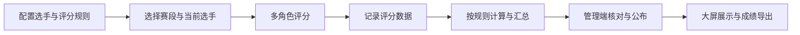
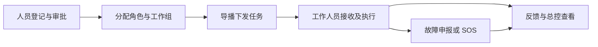
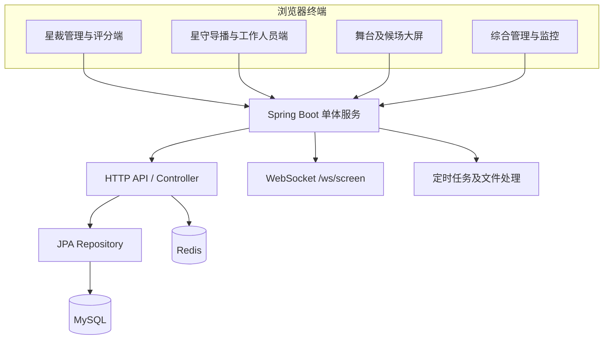

# 星裁 & 星守 · Xingcai & Xingshou

**校园赛事评分与现场指挥调度系统 | 1.0 历史版本**

     

星裁 & 星守是面向校园歌手比赛等活动场景的个人全栈软件项目，将多角色赛事评分、成绩汇总、舞台展示与现场人员协作、任务调度及设备管理结合起来，旨在减少传统纸质评分和现场人工协调的负担。

Xingcai & Xingshou is a campus competition scoring and event coordination prototype built with Java, Spring Boot, MySQL, Redis and browser-based interfaces.

> **项目状态：** 2026 年 3 月启动，因原活动组织安排变化未投入正式比赛使用。当前仓库保留 1.0 历史实现，已纳入保护性维护计划，安全修复和完整运行验收尚未完成。仅建议在隔离的本地测试环境使用，不应直接部署至公网或处理真实参赛者数据。

## 目录

- [项目背景](#项目背景)
- [系统组成与核心功能](#系统组成与核心功能)
- [业务流程](#业务流程)
- [系统架构](#系统架构)
- [技术栈](#技术栈)
- [数据模型](#数据模型)
- [工程目录](#工程目录)
- [本地运行指南](#本地运行指南)
- [安全测试与维护](#安全测试与维护)
- [项目演进](#项目演进)
- [开发者与使用说明](#开发者与使用说明)

## 项目背景

2026 年 3 月初，开发者受朋友委托，希望为校园歌手比赛制作一套电子评分系统。考虑到现成软件的采购成本，开发者选择自行探索实现。在 Gemini 辅助技术选型和开发的过程中，结合在校学习内容选用 Java、Spring Boot 和 MySQL，逐步扩展至 Redis、WebSocket、评委移动终端、舞台大屏及现场指挥调度。

这是开发者第一个由真实业务需求驱动的全栈项目。2026 年 3 月末，原活动组织安排发生变化，项目未正式投入使用。2026 年 4 月 19 日，历史源码上传 GitHub；之后开发重心转向学风建设月智能打卡系统。

## 系统组成与核心功能

### 星裁 · 赛事评分与舞台展示

| 模块 | 功能 |
| --- | --- |
| 赛事管理 | 选手档案、参赛曲目、赛段及出场顺序管理 |
| 专业评委 | 移动端打分、评分提交、网络异常时本地暂存与重试 |
| 学生干部评分 | 独立评分入口、成绩与排名查看 |
| 大众互动 | 二维码票据、投票及互动评分入口 |
| 统分与结果 | 权重配置、去极值计算、分数管理、成绩导出 |
| 舞台大屏 | 当前选手、成绩、排名及动态展示 |
| 候场大屏 | 当前及下一位选手、舞台状态与设备信息 |

### 星守 · 现场指挥与运行协作

| 模块 | 功能 |
| --- | --- |
| 导播总控 | 人员组织、工作组、任务和设备调度 |
| 工作人员终端 | 注册、审批、登录、任务接收与反馈 |
| 人员层级 | 总控、组长、执行人员等层级设计 |
| 消息通讯 | 工作组消息、广播、现场通知 |
| 任务管理 | 向全员、工作组或个人下发任务并接收反馈 |
| 设备管理 | 麦克风分配、设备故障申报与处理 |
| 应急协作 | SOS 求助、告警与处理反馈 |

### 全局管理与辅助能力

- 综合管理入口，汇总评分及现场调度功能。
- WebSocket 实时消息广播，传播舞台、任务、设备等运行状态。
- 运行监控页面、系统日志、历史快照及恢复机制。
- 评委端本地暂存与提交重试机制。

上述功能描述的是源码中已有的实现和设计意图，并不意味着全部通过了真实活动、异常恢复或并发验证。

## 业务流程

### 赛事评分



评分实现包含权重配置及去极值处理，专业评委与学生评分的源码默认权重分别为 60% 和 40%。具体规则以实际配置与实现为准；重复评分、离线补交和并发一致性仍需维护验收。

### 现场指挥



## 系统架构

系统由独立静态 Web 页面与 Java 单体后端组成。星裁和星守共享后端服务及数据基础设施，不采用微服务架构。



MySQL 持久化选手、人员、评分和日志等业务数据；Redis 保存部分赛事状态、配置和运行快照；WebSocket 传播实时消息。部分运行状态还保存在进程或浏览器中。图示为逻辑架构，不代表每条消息都持久化或具有可靠交付保证。

## 技术栈

| 层次 | 技术 |
| --- | --- |
| 后端 | Java 17、Spring Boot 3.5.12、Maven |
| HTTP 容器 | Undertow |
| 数据访问 | Spring Data JPA、MySQL Connector/J |
| 数据与状态 | MySQL、Redis |
| 实时通讯 | Spring WebSocket |
| 身份认证相关 | JWT（JJWT 0.11.5） |
| 前端 | HTML、CSS、JavaScript、Vue 全局脚本 |
| 样式与可视化 | Tailwind CSS、ECharts、Swiper、XLSX 等 |
| 部署方案 | Linux、静态资源服务、Nginx 反向代理 |

依赖版本以 [pom.xml](scoring-system/pom.xml) 和页面实际引用为准。前端不是使用 Vite 或 npm 构建的 SPA。

## 数据模型

| 实体 | 用途 |
| --- | --- |
| Contestant | 参赛选手、节目、赛段与汇总成绩 |
| ScoreRecord | 评分明细、评分者类别、设备及赛段信息 |
| Judge | 专业评委资料 |
| StudentRep | 学生评分代表资料 |
| Staff | 工作人员、角色、工作组及审批状态 |
| ChatMessage | 现场通讯与消息记录 |
| SystemLog | 系统操作日志 |

实体位于 [entity](scoring-system/src/main/java/com/music/scoring_system/entity)，数据访问位于 [repository](scoring-system/src/main/java/com/music/scoring_system/repository)。

## 工程目录

```text
xingcai-xingshou/
├── README.md
├── scoring-system/            # Java 单体后端
│   ├── pom.xml
│   ├── mvnw / mvnw.cmd
│   └── src/
│       ├── main/
│       │   ├── java/com/music/scoring_system/
│       │   │   ├── config/
│       │   │   ├── controller/
│       │   │   ├── dto/
│       │   │   ├── entity/
│       │   │   ├── repository/
│       │   │   ├── task/
│       │   │   └── util/
│       │   └── resources/
│       └── test/
└── frontend_bak/              # 历史静态前端
    ├── admin.html
    ├── shared_judge.html
    ├── cadre_vote.html
    ├── audience_vote.html
    ├── tv_screen.html
    ├── backstage_screen.html
    ├── director_console.html
    ├── mobile_tactics.html
    ├── super_admin.html
    ├── stress_monitor.html
    ├── index.html
    ├── assets/
    └── lib/
```

### 主要页面入口

| 页面 | 用途 |
| --- | --- |
| [admin.html](frontend_bak/admin.html) | 星裁评分管理 |
| [shared_judge.html](frontend_bak/shared_judge.html) | 专业评委 |
| [cadre_vote.html](frontend_bak/cadre_vote.html) | 学生干部评分 |
| [audience_vote.html](frontend_bak/audience_vote.html) | 大众评分 |
| [tv_screen.html](frontend_bak/tv_screen.html) | 舞台主屏 |
| [backstage_screen.html](frontend_bak/backstage_screen.html) | 候场屏 |
| [director_console.html](frontend_bak/director_console.html) | 星守导播总控 |
| [mobile_tactics.html](frontend_bak/mobile_tactics.html) | 工作人员移动终端 |
| [super_admin.html](frontend_bak/super_admin.html) | 综合管理 |
| [stress_monitor.html](frontend_bak/stress_monitor.html) | 运行指标监控 |
| [index.html](frontend_bak/index.html) | 独立辅助页面，非统一业务入口 |

## 本地运行指南

以下为依据现有配置整理的准备步骤，尚未完成洁净环境端到端复验。仅使用专用测试数据库、Redis 和虚拟数据；不要连接历史服务或真实业务数据库。

### 1. 环境准备

- JDK 17、Maven 或仓库提供的 Maven Wrapper。
- MySQL 8.x、Redis。
- 现代浏览器和静态资源服务（例如 Python 3）。
- 历史静态前端不需要 npm 构建。

```bash
git clone https://github.com/XUANFU-h/xingcai-xingshou.git
cd xingcai-xingshou
```

### 2. 数据库与配置

在隔离的 MySQL 实例中建立空数据库，并创建专用测试账号。

```sql
CREATE DATABASE scoring_system CHARACTER SET utf8mb4 COLLATE utf8mb4_unicode_ci;
```

默认配置位于 `scoring-system/src/main/resources/application.properties`。历史实现采用 JPA 自动更新表结构（`ddl-auto=update`），不要对真实数据库执行。建议通过 Spring Boot 环境变量覆盖配置，而非使用历史凭据：

| 环境变量 | 说明 |
| --- | --- |
| SPRING_DATASOURCE_URL | 本地 scoring_system 数据库 JDBC 地址 |
| SPRING_DATASOURCE_USERNAME | 专用测试账号 |
| SPRING_DATASOURCE_PASSWORD | 自行设置的强密码 |
| SPRING_DATA_REDIS_HOST | 本地 Redis 地址 |
| SPRING_DATA_REDIS_PORT | Redis 端口，通常为 6379 |
| SPRING_DATA_REDIS_PASSWORD | 如启用密码则填写 |

默认后端端口为 `8282`。文件上传目录等环境相关配置也需要按本机调整，不得提交真实凭据。

### 3. 后端启动

```bash
cd scoring-system
mvn spring-boot:run
```

也可使用 Linux/macOS 的 `./mvnw spring-boot:run` 或 Windows PowerShell 的 `.\mvnw.cmd spring-boot:run`。本地地址为 `http://127.0.0.1:8282`，WebSocket 路径为 `/ws/screen`。

### 4. 前端预览与联调准备

另开终端，在仓库根目录执行：

```bash
cd frontend_bak
python -m http.server 8081 --bind 127.0.0.1
```

**当前限制：** 部分页面在 localhost 或 file 环境下会选择历史远程服务地址，静态 HTTP 服务也不会自动代理 API。在打开页面前，先检查各页面的 HTTP 和 WebSocket 地址，在本地工作副本中指向隔离测试后端，或设置本地反向代理并调整地址选择逻辑；必要时检查 CORS。不要向历史远程地址提交数据。部分页面依赖 CDN 资源。

完成上述隔离检查后，可访问 `http://127.0.0.1:8081/admin.html` 等页面。此处不是已经验收的一键运行方案。

### 5. 构建与测试入口

```bash
cd scoring-system
mvn clean package
mvn test
```

测试可能需要配置测试数据库和 Redis。当前自动化覆盖有限，构建与多端联调结果以保护性维护验收为准。

## 安全测试与维护

本仓库并非通过安全认证的生产系统。保护性维护范围包括：

- 认证、授权、密码存储、敏感配置及 WebSocket 权限。
- 评分完整性、重复提交、并发、快照恢复及异常处理。
- 接口一致性、本地配置、依赖兼容性、回归测试。
- 运行文档、脱敏演示数据与作品展示材料。

维护原则：保留 Java 单体架构、原有技术栈、业务功能和页面风格；不进行产品重写，不引入 2.0 新功能。修复以最小必要改动和可验证测试为依据。

安全验收前不建议对公网开放。历史凭据若仍有效，应立即作废或轮换，并检查 Git 历史；从当前配置删除凭据并不等于清理历史记录。请勿在公开讨论中附带可用凭据、真实个人信息或漏洞利用细节。

尚无经过本轮验证的吞吐量、延迟、高可用性或正式比赛运行数据。设计容量、代码注释及监控估算值不作为性能测试结论。

## 项目演进

| 阶段 | 说明 |
| --- | --- |
| 2026 年 3 月初 | 由校园赛事评分需求启动开发 |
| 2026 年 3 月 | 扩展至星裁评分与星守现场协作 |
| 2026 年 3 月末 | 活动组织安排变化，未正式投入使用 |
| 2026 年 4 月 19 日 | 历史源码上传 GitHub |
| 后续 | 转向[星迹打卡系统](https://github.com/XUANFU-h/smart-checkin-system) |
| 2026 年 11 月 | 纳入 1.0 保护性维护计划 |

**幕衡校园（MUHENG EventOps）** 是继承星裁 & 星守业务经验的新一代校园活动运行管理产品，独立研发中。本仓库不会承载幕衡 2.0 新功能。

## 开发者与使用说明

开发者：[XUANFU-h](https://github.com/XUANFU-h)。项目实践涉及需求梳理、产品设计、多角色流程规划、AI 辅助全栈实现和部署方案探索。本仓库用于个人项目展示、学习复盘与历史版本维护。

当前仓库未见独立 LICENSE 文件；公开可访问源码不等于授予任意再分发或商业使用许可。第三方依赖及资源遵循其各自许可。

---

**星裁 & 星守 · 2026 | Legacy 1.0**
